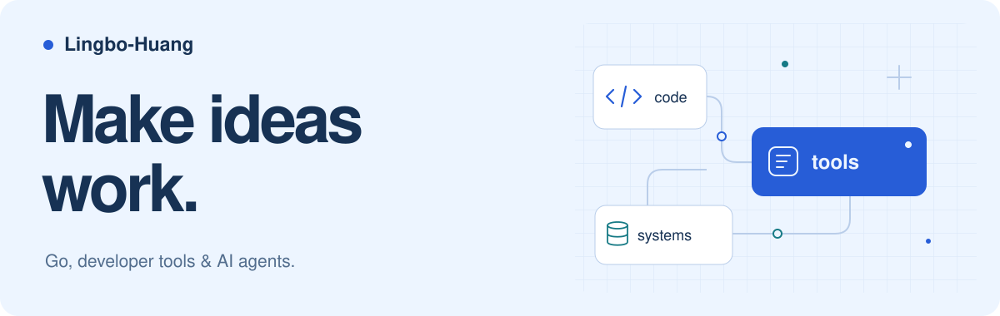

<picture>
  <source media="(prefers-color-scheme: dark)" srcset="assets/hero-dark.svg">
  <source media="(prefers-color-scheme: light)" srcset="assets/hero-light.svg">
  
</picture>

 

  <strong>用 Go 构建开发者工具，探索 AI 工具协作与存储系统。</strong> 
  这里记录我的公开项目、工程实践，以及把想法做出来的过程。

  <a href="#精选项目">精选项目</a> &nbsp; / &nbsp;
  <a href="https://github.com/Lingbo-Huang/GO-s-path-to-godhood">Go 学习笔记</a> &nbsp; / &nbsp;
  <a href="https://github.com/Lingbo-Huang?tab=repositories">全部仓库</a>

## 精选项目

<table>
  <tr>
    <td width="50%" valign="top">
      <h3><a href="https://github.com/Lingbo-Huang/autocurl">autocurl</a></h3>
      
<strong>让真实请求，成为可复现的线索。</strong>

      
捕获 IDE Run/Debug 的真实 HTTP 出站请求并转成 cURL，支持 HTTP/2、gRPC 观测与 WebSocket 握手捕获。

      
Go &nbsp; / &nbsp; HTTP &nbsp; / &nbsp; IDE Plugins

    </td>
    <td width="50%" valign="top">
      <h3><a href="https://github.com/Lingbo-Huang/agentx-connect">agentx-connect</a></h3>
      
<strong>把现有 AI 工具，连接到更多能力。</strong>

      
用轻量 Go 客户端与 MCP 桥接，将现有 AI Host 接入 AgentX 能力与持久化工作交付。

      
Go &nbsp; / &nbsp; MCP &nbsp; / &nbsp; AI Tools

    </td>
  </tr>
  <tr>
    <td width="50%" valign="top">
      <h3><a href="https://github.com/Lingbo-Huang/bitcask-kv">bitcask-kv</a></h3>
      
<strong>从一篇论文，走进存储引擎。</strong>

      
从 Bitcask 论文出发实现的 Go 键值存储，包含 B/B+ 树索引、Merge 回收、批量事务与 HTTP 接口。

      
Go &nbsp; / &nbsp; Storage Engine &nbsp; / &nbsp; B+ Tree

    </td>
    <td width="50%" valign="top">
      <h3><a href="https://github.com/Lingbo-Huang/GO-s-path-to-godhood">Go 学习与实践</a></h3>
      
<strong>用代码，理解每一个细节。</strong>

      
记录 Go 语言、并发、网络编程、数据结构与算法的学习实践，把遇到的问题写成可以运行的代码。

      
Go &nbsp; / &nbsp; Concurrency &nbsp; / &nbsp; Algorithms

    </td>
  </tr>
</table>

## 技术与兴趣

- **工程基础**：Go、并发、网络编程、KV 存储。
- **工具实践**：请求观测、IDE 扩展、跨平台 CLI。
- **AI 探索**：MCP、Host 集成、Agent 工具协作。

## 一些其他尝试

[chatbot-play](https://github.com/Lingbo-Huang/chatbot-play) · 围绕情感支持对话的 AI 应用实验。  
[agent-game](https://github.com/Lingbo-Huang/agent-game) · 结合确定性状态与可选 AI 的互动叙事游戏。

---

Build thoughtfully. Keep learning.

