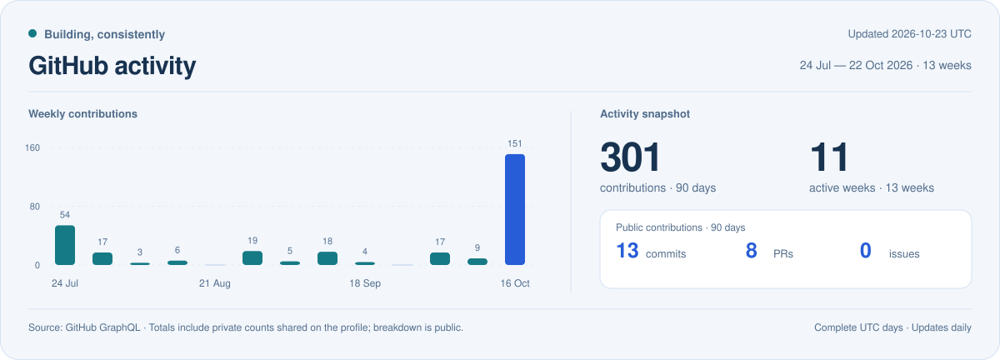

<picture>
  <source media="(prefers-color-scheme: dark)" srcset="assets/hero-dark.svg">
  <source media="(prefers-color-scheme: light)" srcset="assets/hero-light.svg">
  
</picture>

<a href="README.md">中文</a> &nbsp; / &nbsp; <a href="README.en.md">English</a>

  <strong>以 Golang / Python 构建后端与 AI 系统。</strong> 
  9+ 年计算机领域积累，覆盖 API 网关、AI 网关、LLM 训练与推理、Agent RL 与 Agent 应用开发。

  <a href="#能力版图">能力版图</a> &nbsp; / &nbsp;
  <a href="#精选项目">精选项目</a> &nbsp; / &nbsp;
  <a href="#持续构建">持续构建</a> &nbsp; / &nbsp;
  <a href="https://github.com/Lingbo-Huang?tab=repositories">全部仓库</a>

## 能力版图

从服务接入与流量治理，到模型训练、推理服务和 Agent 应用，把工程基础与 AI 系统连接起来。

| 方向 | 能力与关注点 |
| :--- | :--- |
| **Golang / Python** | 后端服务、CLI、开发工具与 AI 应用工程 |
| **API 网关** | 协议代理、路由、鉴权、限流与负载均衡 |
| **AI 网关** | 模型接入、请求路由、调用治理与可观测性 |
| **LLM 训练与推理** | 模型训练、推理服务、实验与评测 |
| **Agent RL** | Agent 强化学习、奖励设计与评估 |
| **Agent 应用开发** | Agent 编排、工具调用、MCP、记忆与交互 |

公开工程见下方精选项目；AI 网关、LLM 与 Agent RL 的案例材料将在 <a href="docs/casebook.md">案例集</a> 逐步补充。

## 精选项目

<table>
  <tr>
    <td width="50%" valign="top">
      <h3><a href="https://github.com/Lingbo-Huang/autocurl">autocurl</a></h3>
      
<strong>开发者工具</strong>

      
捕获 IDE Run/Debug 的真实 HTTP 出站请求并生成 cURL，支持 HTTP/2、gRPC 传输观测与 WebSocket 握手捕获。

      
Go &nbsp; / &nbsp; HTTP &nbsp; / &nbsp; IDE Plugins

    </td>
    <td width="50%" valign="top">
      <h3><a href="https://github.com/Lingbo-Huang/chatbot-play">chatbot-play</a></h3>
      
<strong>Python 与 Agent 应用</strong>

      
Python/FastAPI + React 的 AI 对话应用，包含 Agent 意图路由、流式回复、对话记忆、Prompt 版本与调用追踪。

      
Python &nbsp; / &nbsp; FastAPI &nbsp; / &nbsp; React

    </td>
  </tr>
  <tr>
    <td width="50%" valign="top">
      <h3><a href="https://github.com/Lingbo-Huang/gateway">gateway</a></h3>
      
<strong>API 网关工程实践</strong>

      
Go API 网关实践，包含 HTTP/TCP/gRPC 代理、JWT、流控、IP 策略与负载均衡。

      
Go &nbsp; / &nbsp; API Gateway &nbsp; / &nbsp; Networking

    </td>
    <td width="50%" valign="top">
      <h3><a href="https://github.com/Lingbo-Huang/agentx-connect">agentx-connect</a></h3>
      
<strong>AI 工具接入</strong>

      
用 Go 客户端和 MCP 桥接连接现有 AI Host，提供跨平台安装器、CLI 及 Codex/Claude 插件。

      
Go &nbsp; / &nbsp; MCP &nbsp; / &nbsp; Agent Tools

    </td>
  </tr>
  <tr>
    <td width="50%" valign="top">
      <h3><a href="https://github.com/Lingbo-Huang/bitcask-kv">bitcask-kv</a></h3>
      
<strong>存储系统</strong>

      
基于 Bitcask 论文实现的 Go 键值存储，包含 B/B+ 树索引、Merge 回收、批量事务与 HTTP 接口。

      
Go &nbsp; / &nbsp; Storage Engine &nbsp; / &nbsp; B+ Tree

    </td>
    <td width="50%" valign="top">
      <h3><a href="https://github.com/Lingbo-Huang/agentx-official-services">AgentX Services</a></h3>
      
<strong>Agent 服务工程</strong>

      
Service Pack 离线校验与 Skill-to-Service 工具链，包含版本契约、文件校验和服务编写流程。

      
Go &nbsp; / &nbsp; Service Contracts &nbsp; / &nbsp; Tooling

    </td>
  </tr>
</table>

gateway 为基于 <a href="https://github.com/e421083458/go_gateway">go_gateway</a> 的工程实践，项目保留上游模块路径。

## 持续构建

<picture>
  <source media="(prefers-color-scheme: dark) and (max-width: 600px)" srcset="assets/activity-mobile-dark.svg">
  <source media="(max-width: 600px)" srcset="assets/activity-mobile-light.svg">
  <source media="(prefers-color-scheme: dark)" srcset="assets/activity-dark.svg">
  <source media="(prefers-color-scheme: light)" srcset="assets/activity-light.svg">
  
</picture>

由 GitHub Actions 每日更新，统计口径见 <a href="docs/profile-maintenance.md">维护文档</a>。

## 笔记与实验

- [Go 学习与实践](https://github.com/Lingbo-Huang/GO-s-path-to-godhood)：语言、并发、网络编程与算法。
- [AI / LLM / Agent 案例集](docs/casebook.md)：AI 网关、LLM 训练推理与 Agent RL 的案例入口，随公开资料逐步补充。
- [agent-game](https://github.com/Lingbo-Huang/agent-game)：确定性状态与可选 AI 驱动的互动叙事。

---

Build reliable systems. Explore intelligent ones.

